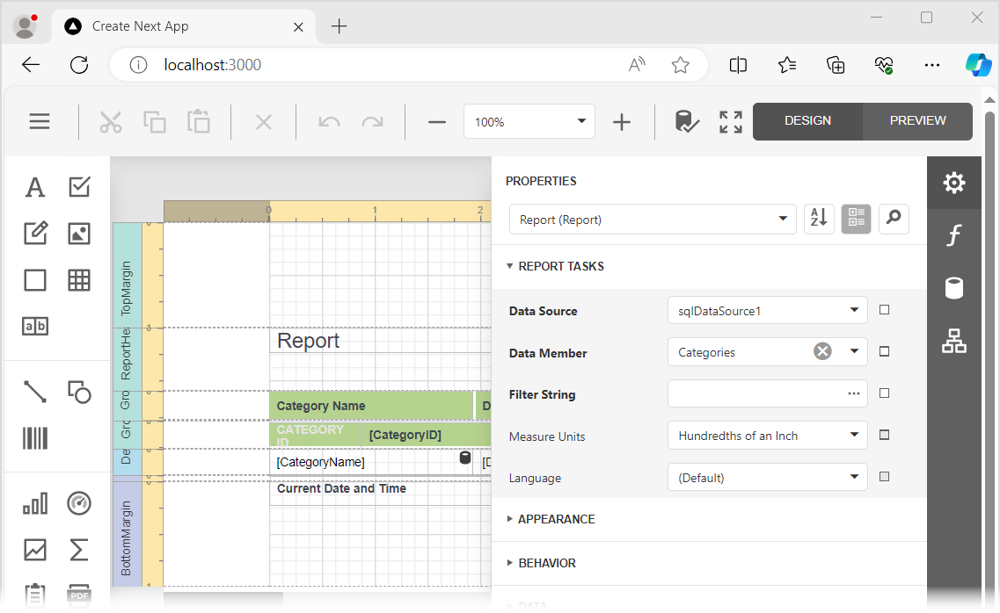

<!-- default badges list -->

[](https://supportcenter.devexpress.com/ticket/details/T1272867)
[](https://docs.devexpress.com/GeneralInformation/403183)
[](#does-this-example-address-your-development-requirementsobjectives)
<!-- default badges end -->
# Reporting for React - Customize a Web Report Designer in a React App (Next.js)

This example incorporates the Web Report Designer into a client-side app built with React. The example consists of two parts:

- The [ServerSideApp](ServerSideApp) folder contains the backend project. The project is an ASP.NET Core application that enables [cross-domain requests (CORS)](https://developer.mozilla.org/en-US/docs/Web/HTTP/CORS) (Access-Control-Allow-Origin) and implements custom web report storage.

- The [react-report-designer](react-report-designer) folder contains the client application built with React.

## Quick Start

### Server

In the *ServerSideApp/ServerSideApp* folder, run the following command:


```
dotnet run
```

The server starts at http://localhost:5000. To debug the server, run the application in Visual Studio.

### Client

In the *react-report-designer* folder, run the following commands:

```
npm install
npm run dev
```

Open `http://localhost:3000/` in your browser to view the result. The application displays the Web Report Designer.




## Customization Scenarios

This project contains code snippets that demonstrate client-side customization and appear in our online help topics. Each code snippet is stored in a `page.tsx` file in a separate folder. After you run the project, navigate to the following locations to see the result:

| Location | Description | File to Review |
| --- | --- | --- |
| /client-side-api | Handles `TabChanged` to display the active report's name and `ReportOpened` to change report units to tenths of a millimeter. Uses `PreviewCustomizeMenuActions` to hide **Print Page** and add a custom preview command. | [page.tsx](react-report-designer/app/client-side-api/page.tsx) |
| /save-modified-report | Adds buttons to save the modified report in the active tab as `Rep1` or save modified reports across all tabs. The save-all handler assigns names to new reports, resets each tab's modified state after saving, and displays a success notification. | [page.tsx](react-report-designer/app/save-modified-report/page.tsx) |
| /manage-properties-panel | Uses `BeforeRender` and `GetPropertyInfo` to hide or disable **Properties panel** editors and sections for reports and labels, including watermark settings, the CSV separator, and **Can Grow**. | [page.tsx](react-report-designer/app/manage-properties-panel/page.tsx) |
| /report-designer-api | Adds a button that calls `RunWizard('NewViaReportWizard')` through the designer reference to open the New Report Wizard. | [page.tsx](react-report-designer/app/report-designer-api/page.tsx) |
| /open-report | Adds a button that calls `OpenReport("TestReport")` to load the predefined report. | [page.tsx](react-report-designer/app/open-report/page.tsx) |
| /save-report | Adds a button that calls `SaveReport()` through the designer reference to save the current report. | [page.tsx](react-report-designer/app/save-report/page.tsx) |


## Documentation

- [Create a React Application with Web Report Designer](https://docs.devexpress.com/XtraReports/119339)
- [Report Designer Server-Side Configuration (ASP.NET Core)](https://docs.devexpress.com/XtraReports/400196)

## More Examples

* [Reporting for React - Integrate Document Viewer in React App](https://github.com/DevExpress-Examples/reporting-react-integrate-web-document-viewer)


<!-- feedback -->
## Does This Example Address Your Development Requirements/Objectives?

[](https://www.devexpress.com/support/examples/survey.xml?utm_source=github&utm_campaign=reporting-react-end-user-designer-customizations&~~~was_helpful=yes) [](https://www.devexpress.com/support/examples/survey.xml?utm_source=github&utm_campaign=reporting-react-end-user-designer-customizations&~~~was_helpful=no)

(you will be redirected to DevExpress.com to submit your response)
<!-- feedback end -->
